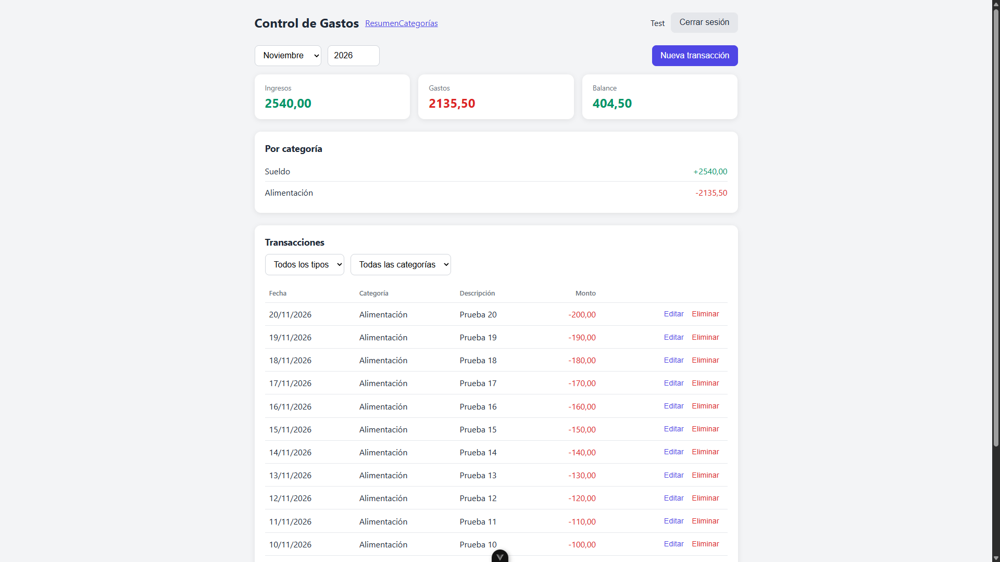
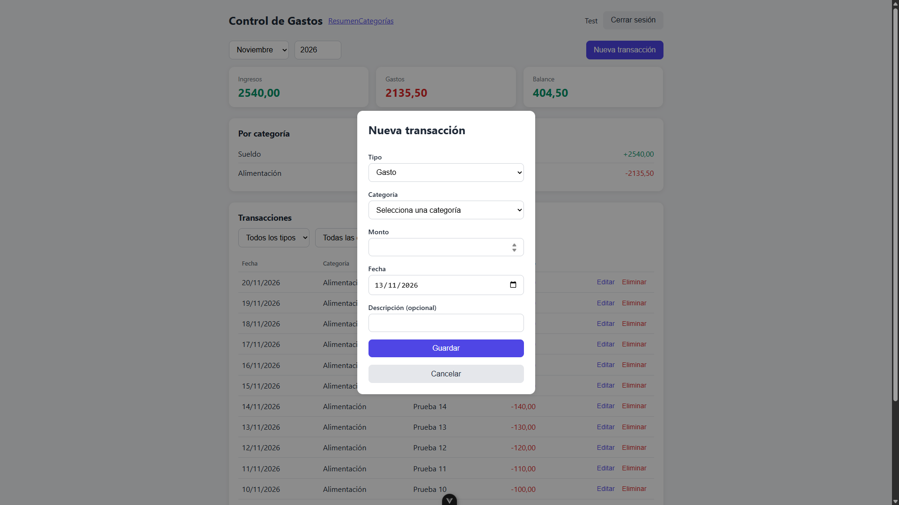
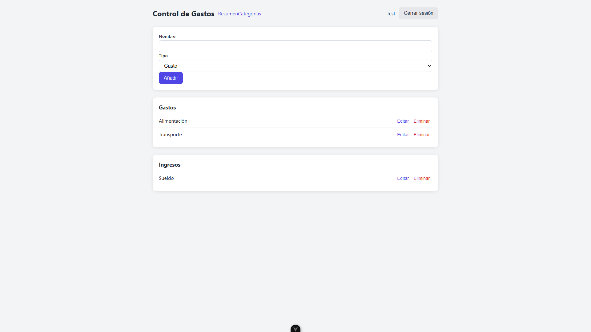

# Control de Gastos - Front

Interfaz web en **Vue 3** para la [API de Control de Gastos](https://github.com/FernandoYtusaca/control-gastos). Permite registrarse, iniciar sesión, gestionar categorías y transacciones, y ver el resumen mensual de ingresos, gastos y balance.

## Capturas





## Características

- Registro, login y logout con token (Laravel Sanctum)
- Rutas protegidas: sin sesión no se accede al panel
- Resumen mensual con ingresos, gastos, balance y detalle por categoría
- Lista de transacciones con filtros por mes, año, tipo y categoría, y paginación
- Crear, editar y eliminar transacciones desde un formulario modal
- Gestión de categorías (crear, renombrar, eliminar)
- Manejo de errores de validación y de reglas de negocio de la API

## Tecnologías

- Vue 3 (Composition API, `<script setup>`)
- Vite
- Vue Router (con guardas de navegación)
- Pinia
- CSS propio, sin librerías de UI

## Requisitos

- Node.js 20.19+ o 22+
- La [API de Control de Gastos](https://github.com/FernandoYtusaca/control-gastos.git) corriendo en local

## Instalación

```bash
git clone https://github.com/FernandoYtusaca/control-gastos-front.git
cd control-gastos-front
npm install
npm run dev
```

La app queda en `http://localhost:5173`.

El archivo `.env` define la URL de la API. Por defecto apunta al backend local:

```
VITE_API_URL=http://127.0.0.1:8000/api
```

Cambia ese valor si tu API corre en otra dirección y reinicia `npm run dev`.

## Scripts

| Comando | Descripción |
|---|---|
| `npm run dev` | Servidor de desarrollo |
| `npm run build` | Compila para producción |
| `npm run lint` | Revisa el código con ESLint |
| `npm run format` | Da formato con Prettier |

## Estructura

```
src/
├── components/   AppHeader, SummaryCards, TransactionList, TransactionForm
├── router/       rutas y guardas de autenticación
├── services/     api.js: cliente fetch con token y manejo de errores
├── stores/       auth.js: sesión con Pinia
├── utils/        formato de montos y fechas
└── views/        LoginView, RegisterView, DashboardView, CategoriesView
```

## Autor

Saúl Fernando Ytusaca Quispe: https://www.linkedin.com/in/saul-fernando-ytusaca-quispe/